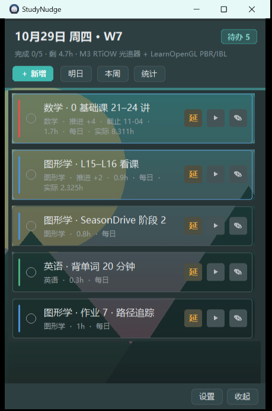
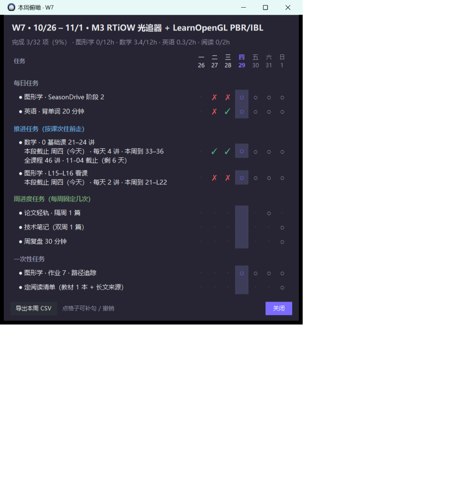

# StudyNudge · 学习任务提示器

> 一个常驻 Windows 桌面的小窗：按你的 **Markdown 任务表** 每天列出该做的事，勾选完成、延期、提前做，并给出本周俯瞰。
> 专为「长期计划 + 每天执行」设计（考研 / 自学 / 项目推进），不需要账号、不联网、数据全在本地。





## 特点

- **任务表就是文件**：一个 `data/任务列表.md`，改文件 = 改任务，保存后 1 分钟内自动生效，不用重启
- **三种节奏**：每日任务 / 推进任务（课次自动往后走）/ 周进度任务（每周固定几次），用不同颜色框区分
- **课次自动推进**：备注里写 `每天 4 讲`，勾完第二天标题自动变成 `21–24 讲`，并回写 Markdown；取消勾选会退回上一档
- **延期**：一键延到明天，次日置顶并标红；不会挤掉明天原有的任务
- **提前做**：当天清空后，底部列出「明日 · 可提前做」，学有余力就往前推
- **本周俯瞰**：任务 × 7 天网格，可补勾漏勾，推进型会算出「本周推到第几讲」
- **全屏勿扰**：检测到游戏 / 视频全屏时不弹窗、不抢焦点，退出后补提醒
- **主题与背景**：7 个预设色 + 任意自定义色，可上传背景照片并调透明度，卡片是真·半透明（背景花纹会透出来）
- **纯标准库 + Pillow / pystray**：无框架、无账号、无遥测

## 下载

到 [Releases](../../releases) 下载 `StudyNudge-v1.0.zip`，解压后双击 `StudyNudge.exe`。

> Win11 默认把新托盘图标收进任务栏 `^` 溢出区，拖出来即可常显。

## 快速开始

1. 首次运行会在程序目录生成 `data/任务列表.md`
2. 用记事本编辑它：

```markdown
## 0.5 当前执行（StudyNudge 读取）

- [math] 数学 · 高数 第 3 章 | 1.5 | 每天 1 节 · 共 12 章 · 截止 2026-12-31
- [graphics] 图形学 · GAMES101 L13–L14 看课 | 1.0 | 每天 2 讲
- [english] 英语 · 背单词 20 分钟 | 0.3 | 每天 20 个新词
- [reading] 阅读 · 教材 1 章 | 1.0 | 读完写 3 句摘要 | 每周 3,6
```

3. 保存，窗口 1 分钟内自动更新

### 格式

```
- [学科(#子项)] 标题 | 预估小时 | 备注 | 排期
```

| 字段 | 说明 |
|---|---|
| 学科 | `math` / `graphics` / `english` / `reading` / `other`，也可写中文 |
| 子项 | 同一学科多条任务时用 `#子项` 区分，如 `graphics#hw` |
| 小时 | 数字，用于统计和「剩余工时」 |
| 备注 | 可写 `每天 4 讲`（课次推进）、`共 46 讲 · 截止 11-04`（板块进度与截止日） |
| 排期 | 不写 = 每天；`每周 3,6` = 周三周六；`一次 2026-11-02` = 一次性；`从 10-29` = 那天才出现 |

完整说明见 [使用说明.md](使用说明.md)；不想手写格式，可以把 [任务列表-给AI的提示词.md](任务列表-给AI的提示词.md) 里的提示词丢给任意对话模型，让它把你的计划转成这个格式。

## 从源码运行

```powershell
pip install -r requirements.txt
python main.py
```

自检（不弹窗，跑一遍核心流程）：

```powershell
python main.py --selftest
```

## 打包 exe

```powershell
python -m PyInstaller --noconfirm --clean --windowed --onedir --name StudyNudge `
  --icon assets\icon.ico --add-data "assets;assets" `
  --hidden-import pystray._win32 --hidden-import PIL._tkinter_finder main.py
```

产物在 `dist\StudyNudge\`。打包后数据目录 = exe 同级 `data\`，只读资源在 `_internal\`（见 `paths.py`）。

## 目录结构

```
main.py        入口：DPI、单实例、异常日志、--selftest
ui.py          界面：主窗、行渲染、滚动引擎、对话框
store.py       任务模型、完成/延期/统计、路径与设置
progress.py    解析 Markdown 任务表、同步、课次推进
theme.py       主题色派生、背景合成、卡片半透明
tray.py        系统托盘（pystray）
startup.py     开机自启（快捷方式）
winpos.py      Win32 窗口定位、全屏检测
paths.py       源码 / 打包两种运行方式的路径
assets/        图标（原创 Q 版头像，Pillow 生成）
tools/         make_icon.py 图标生成脚本
```

## 说明

- 数据全部在本地 `data/`，不上传、不联网
- 图标是用 `tools/make_icon.py` 程序化绘制的原创头像，MIT 范围内可自由使用
- 仅支持 Windows（依赖 Win32 API：DPI、全屏检测、快捷方式）

## License

[MIT](LICENSE)
